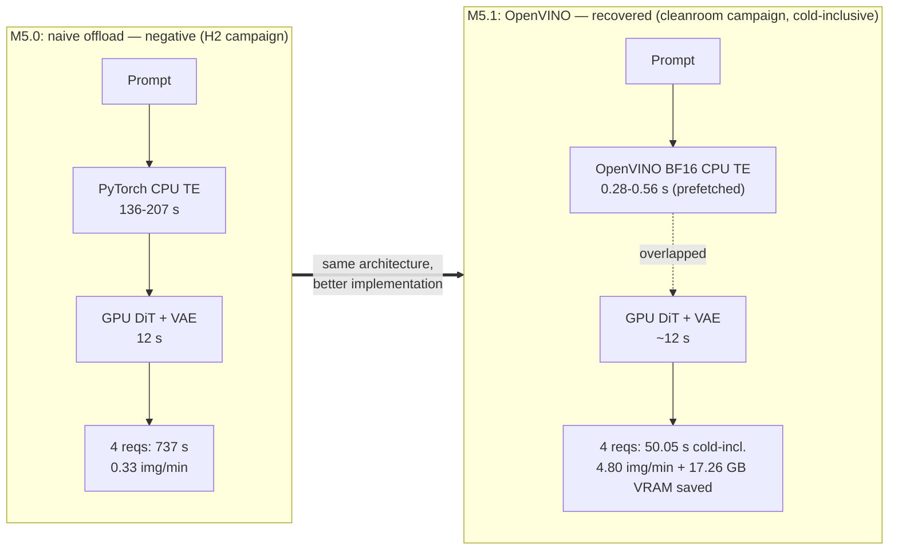

# Making Generative AI Faster

*From algorithmic insights to measurable system performance — a hands-on,
evidence-first inference-optimization course on Qwen-Image-2.1 × AMD ROCm.*

**让生成式 AI 更快 —— 从算法优化原理到可复现的系统性能提升。**
中文版：[README.zh-CN.md](README.zh-CN.md) · 课程：English / [中文](README.zh-CN.md)

Every claim below traces to a committed run record measured on a single AMD
Radeon PRO W7900 (gfx1100, 48 GB, ROCm 7.2.1, PyTorch 2.9.1) — and you
reproduce the whole methodology yourself on a free Radeon Cloud GPU.

---

## Interactive Jupyter labs — learn by doing

**[Start the 9-module Jupyter laboratory](notebooks/README.md)** · [中文实践入口](notebooks/README.zh-CN.md) · [M1 baseline notebook](notebooks/01_baseline_and_uncertainty.ipynb)

Each module now has **paired English/Chinese executable notebooks (18 total)** with **three declared modes**: `REFERENCE` (offline CPU analysis of the frozen campaign — the GitHub CI profile), `GPU_CLASSROOM` (your own bounded physical W7900 measurements — the default student experience after Radeon Cloud onboarding), and `GPU_RESEARCH` (full frozen protocol). Set `COURSE_MODE` in the first cell and Restart & Run All; an admission banner shows the admitted GPU or the exact blocker. Physical GPU measurement is the primary practical validation; committed evidence stays the reference and scientific comparison source. Classroom exercises are bounded teaching experiments — a formal speedup claim needs the research protocol.

## The result (real, measured, honestly caveated)

Same prompt, same seed, same GPU — the engineering changed, and so did the
model variant, sampling schedule and precision:

| B0 frozen baseline · bf16, 40 steps · **55.21 s** | BEST · turbo-int8, 8 steps · **9.02 s** |
|:---:|:---:|
|  |  |
|  |  |

**6.12× faster, measured end-to-end** (warm median; B0 pools two independent
9-run sessions, n=9 elsewhere, 1024×1024):

| Stage | Config | Warm | vs baseline | Peak VRAM |
|---|---|---|---|---|
| **B0** | bf16, 40 steps (frozen baseline) | 55.21 s | 1.00× | 37.7 GB |
| L1 | Turbo 8-step (*less computation*) | 12.13 s | 4.55× | 37.7 GB |
| F1 | ck attention (*faster computation*) | 45.09 s | 1.22× | 37.7 GB |
| F2 | INT8 weights (*memory first: −6.7 GB*) | 51.09 s | 1.08× | **31.0 GB** |
| **BEST** | Turbo INT8 + default attention | **9.02 s** | **6.12×** | **31.0 GB** |

> ⚠ **The honest caveat (this course's core value):** the 6.12× changes
> model variant (turbo), schedule (8 steps) and precision (INT8) — not an
> invisible implementation detail — so BEST's images legitimately differ from
> B0's (LPIPS distance 0.19–0.30; INT8 itself is near-lossless, fidelity
> 0.005–0.031 vs a 0.0000 noise floor). Whether turbo's output is acceptable,
> especially poster typography at native resolution, is a **human three-tier
> verdict (无感/略降/不可接受) that remains `PENDING_HUMAN_REVIEW` for
> BEST** — an independent gate from the M5.1 verdict below. Speed never
> overrides the quality gate. Full grids:
> [`evidence/quality/BEST/quality_grid.png`](evidence/quality/BEST/quality_grid.png) ·
> native-res crops: [`quality_crops_poster.png`](evidence/quality/BEST/quality_crops_poster.png).

## The instructive arc: a negative result, recovered — and its ceiling

This is the course's flagship story, taught end-to-end in
[M5](course/M05_parallel_heterogeneous/LESSON.md) →
[M5.1](course/M05_parallel_heterogeneous/M5_1_OPENVINO_CPU_TE.md):

1. **M5.0 (negative):** offloading the 8B text encoder to CPU frees 16.8 GB
   VRAM but is 152–391× slower; pipelined CPU+GPU execution **loses 14× in
   throughput** despite 50.4 s of timestamp-proven overlap.
2. **M5.1 (recovery):** a better CPU *implementation* — OpenVINO BF16 — makes
   CPU encoding viable: **331–480× faster on positive prompts**, conditioning
   PASS, **−17.26 GB VRAM peak**, owner-accepted quality (2026-11-05, scope
   C1b-vs-G only). Its INT8 sibling **fails the empty-negative conditioning
   gate (relL2 28.25%)** and stays exploratory — no acceptance can override
   a numerical FAIL.
3. **M5.1 (the lesson):** local gain ≠ system gain. Warm per-request service
   latency improves **1.081×** (13.031 → 12.060 s) while actual four-request
   batch throughput improves only **1.029×** (4.42 → 4.55 img/min) — three
   different questions, three different numbers (cold-inclusive: 1.33×), one
   Amdahl ceiling.
4. **The client lesson (measure the measurer):** the benchmark client itself
   became part of the bottleneck — a per-request monitor teardown worth
   ~0.5–1.0 s/request sat inside *both* arms' batch gaps. Fixing only C's
   client (+4.85%, honest near-miss of a pre-registered 5% exploratory
   target) made a C-vs-A "architecture" quote quietly measure the harness.
   The controlled 2×2 follow-up — {A, C} × {original, fast client} — is the
   course's flagship fairness experiment
   ([P4 study](docs/publication-closure/P4_FAIR_CLIENT_AB.md)).



*Population discipline (why these exact pairs):* every time/throughput pair
above comes from **one run population** — the M5.0 side is the frozen H2
campaign record (`737.1 s → 240/737.1 = 0.33 img/min`), the M5.1 side is the
cleanroom campaign's cold-inclusive C1b session (`50.05 s → 4.80 img/min`;
VRAM is the campaign warm-session definition). The **warm** steady-state
numbers are deliberately *not* in this diagram because they answer a different
question — see item 3 above (service 1.081×, actual batch throughput 1.029× =
4.42 → 4.55 img/min). Mixing populations (e.g. `737 s` with `0.35 img/min`,
or `50 s` with `4.55 img/min`) was a real defect in an earlier revision of
this diagram and is now CI-enforced
([`check_metric_pairs.py`](scripts/course-quality/check_metric_pairs.py),
provenance in [`P1_METRIC_PROVENANCE.json`](docs/publication-closure/P1_METRIC_PROVENANCE.json)).

## What you will learn: the three ways to make inference faster

**① Less Computation** — remove work instead of speeding it up. Step
distillation 40 → 8 is the biggest single lever (4.55×) — but not 5× (Amdahl
caps it at ≈4.6×), per-step cost is unchanged (1.345 → 1.337 s), and the
output legitimately changes → a quality tradeoff a human must judge.

**② Faster Computation** — same work, faster kernels. Attention backends
(ck: 1.22×) and INT8 (1.08× at 1024², but −6.7 GB VRAM). Independent gains
never multiply (4.55 × 1.08 × 1.25 "predicts" 6.14×; measured 6.12× — and ck
adds *nothing* on the int8-turbo path: 9.023 vs 9.022 s, fully overlapping).

**③ Parallel & Heterogeneous Computing** — move work to the right engine and
overlap it. Measured the hard way in M5.0/M5.1 above: the payoff equals the
fraction of the critical path you relocate, minus every handoff you add.

The methodology spine — *Measure → Model → Hypothesize → Optimize → Validate
→ Explain → Reproduce → Contribute* — is taught explicitly in
[course/METHODOLOGY.md](course/METHODOLOGY.md) and applied in every module.

## Start in three steps (~15 minutes to your first image)

**1 · Get a free Radeon Cloud GPU.** Apply via the
[Radeon Cloud login](https://developer.amd.com.cn/login?source=WmhWQBvrH)
(Chinese step-by-step guide:
[申请与使用教程](https://mp.weixin.qq.com/s/dOAIzJ2qsWPmBSH67q41aA); docs:
[radeon-cloud-docs (中文)](https://amd-aim.github.io/radeon-cloud-docs/zh-cn/)),
then start a **single-GPU Linux Notebook with a PyTorch-ROCm image**.
Requirements: ~60 GB free disk (25.5 GB pinned models + ComfyUI), one gfx1100-class
48 GB GPU for the full course (24 GB cards can run smoke variants and all
evidence-reading tracks). Quotas are shown in the platform console — this
course never promises a specific number. [Readiness audit of a live instance →](docs/RADEON_CLOUD_READINESS.md)

**2 · Clone the course into `/workspace`:**

```bash
cd /workspace
git clone https://github.com/AIwork4me/qwen-image-inference-tuning-course.git
```

**3 · Run one command and get your first image:**

```bash
cd qwen-image-inference-tuning-course
bash scripts/cloud/start.sh
```

The script diagnoses your instance, borrows the preinstalled ROCm PyTorch
(never reinstalls it), fetches ComfyUI at the pinned commit, stages the
minimum SHA256-pinned model set (~25.5 GB, resumable), runs the fail-closed
doctor, and generates one bounded smoke image whose path it prints.
[Full quickstart + tested recovery guide →](docs/RADEON_CLOUD_QUICKSTART.md)

**No GPU yet?** Every module has a `REFERENCE` mode: read committed
measurements, recompute speedups, analyze profiling data — and submit a
CPU-only improvement PR ([Mode A below](#choose-your-learning-track)).

## Choose your learning track

| Mode | For | Time | What you do |
|---|---|---|---|
| **A — REFERENCE** (no GPU) | everyone | 2–4 h | read committed run records, recompute ratios, judge claims vs evidence, improve docs/tests via PR |
| **B — GPU_CLASSROOM** (default on your W7900) | provisioned students | +2–3 h | your own bounded physical measurements per module (≈5 min/arm, 1 prompt), auto-labelled `BOUNDED_PHYSICAL_COMPARISON` |
| **C — GPU_RESEARCH** (full reproduction) | advanced | +6–10 h GPU | strict doctor, pinned models, full protocols (3 prompts × 3 seeds), repeated A/B, quality gates, uncertainty, contribution |

Details: [docs/CLASSROOM_WORKFLOWS.md](docs/CLASSROOM_WORKFLOWS.md) ·
中文：[docs/CLASSROOM_WORKFLOWS.zh-CN.md](docs/CLASSROOM_WORKFLOWS.zh-CN.md)

## Curriculum (8 course hours + labs + a 100-minute lecture)

| Module | Teaches | Key measured fact |
|---|---|---|
| [M0 Setup & discipline](course/M00_setup_and_discipline/LESSON.md) ([中文](course/M00_setup_and_discipline/LESSON.zh-CN.md)) | fail-closed preflight, evidence culture | doctor gate, pinned stack |
| [M1 Baseline](course/M01_baseline/LESSON.md) ([中文](course/M01_baseline/LESSON.zh-CN.md)) | measuring before optimizing | 55.21 s, 1.345 s/step, reproducibility |
| [M2 Profiling](course/M02_profiling/LESSON.md) ([中文](course/M02_profiling/LESSON.zh-CN.md)) | pipeline + kernel tracing, Amdahl | GEMM 61.3% / attention 32.4% of busy |
| [M3 Less computation](course/M03_less_computation/LESSON.md) ([中文](course/M03_less_computation/LESSON.zh-CN.md)) | step distillation, attribution | 4.55× — and why it isn't 5× |
| [M4 Faster computation](course/M04_faster_computation/LESSON.md) ([中文](course/M04_faster_computation/LESSON.zh-CN.md)) | attention backends, INT8, combinations | ck 1.22×; INT8 1.08× + memory win; LF2=LF3 |
| [M5.0 CPU PyTorch baseline](course/M05_parallel_heterogeneous/LESSON.md) ([中文](course/M05_parallel_heterogeneous/LESSON.zh-CN.md)) | why CPU TE offload/pipelining can lose | measured 14× throughput loss |
| [M5.1 OpenVINO CPU TE](course/M05_parallel_heterogeneous/M5_1_OPENVINO_CPU_TE.md) ([中文](course/M05_parallel_heterogeneous/M5_1_OPENVINO_CPU_TE.zh-CN.md)) | same-host A/B, precision gates, the three speedup notions | 331–480×; service 1.081× vs batch 1.029×; −17.26 GB |
| [M6 Combined & quality gate](course/M06_combined_quality/LESSON.md) ([中文](course/M06_combined_quality/LESSON.zh-CN.md)) | BEST selection, LPIPS semantics | 6.12×; human verdict binding |
| [M7 Student challenge](course/M07_student_challenge/CHALLENGES.md) ([中文](course/M07_student_challenge/CHALLENGES.zh-CN.md)) | open-source contribution practice | 7 graded tasks + Fork→PR tutorial |

Full plan: [course/SYLLABUS.md](course/SYLLABUS.md) ·
[中文大纲](course/SYLLABUS.zh-CN.md) ·
Methodology: [EN](course/METHODOLOGY.md) · [中文](course/METHODOLOGY.zh-CN.md) ·
Lecture (2026-11-19, 100 min): [EN](course/LECTURE_DEMO.md) ·
[中文](course/LECTURE_DEMO.zh-CN.md)

## Run the lab yourself

```bash
bash scripts/cloud/start.sh --all-models   # staged setup (or add models later)
.venv-lab/bin/python -m lab doctor         # strict preflight (formal runs)
.venv-lab/bin/python -m lab baseline       # frozen B0 baseline (~16 min on W7900-class)
.venv-lab/bin/python -m lab profile        # pipeline + rocprofv3 kernel profiling
.venv-lab/bin/python -m lab run --experiment L1 [--smoke]   # F1 F2 LF1-3 BEST H1 H2
.venv-lab/bin/python -m lab quality --experiment F2
.venv-lab/bin/python -m lab report [--scope reference|student|all] [--write]
```

**GPU time is a metered student resource.** Classroom work uses bounded
`--smoke` variants (1–3 min); full formal sessions cost 4–16 min each (budget
table in the [quickstart](docs/RADEON_CLOUD_QUICKSTART.md)). The slow CPU
experiments (H1/H2) are taught from committed evidence and are opt-in. Stop
or destroy your instance when idle — `runs/` persists with `/workspace`.
Your measurements live under `runs/` and can never modify the frozen
reference evidence under `evidence/`.

## Evidence & reproducibility

- `evidence/results/` — every run record (timing, VRAM, attention-path log
  evidence, image hashes), env snapshots, profiling analyses, SUMMARY +
  charts; the official campaign is pinned in
  [`lab/reference_runs.json`](lab/reference_runs.json).
- `evidence/quality/`, `evidence/samples/` — paired grids, native-resolution
  typography crops, B0 & BEST measured images.
- [docs/CLAIM_EVIDENCE_MATRIX.md](docs/CLAIM_EVIDENCE_MATRIX.md) — 25 claims,
  each with its evidence file and caveats;
  [course/data/verified_claims.json](course/data/verified_claims.json) —
  machine-checkable registry (23 claims) validated by CI.
- [docs/REPRODUCTION_GUIDE.md](docs/REPRODUCTION_GUIDE.md) ·
  [中文](docs/REPRODUCTION_GUIDE.zh-CN.md) — exact commands and hazards.
- [docs/case-study/](docs/case-study/) — the verbatim P0–P6 engineering
  journals (reading homework).
- [docs/M51_RESULTS.md](docs/M51_RESULTS.md) — the M5.1 campaign;
  [docs/quality-v2/](docs/quality-v2/) — course-v2 independent audits
  (baseline, claims, image evidence, pipeline-overhead study).

## Contribute your first optimization PR

Issue → Hypothesis → Reproducer → Code → Tests → Evidence → PR → Review:

1. Pick a task from
   [M7 challenges](course/M07_student_challenge/CHALLENGES.md) (entry-level:
   docs/tests; advanced: controlled performance experiments).
2. Follow the
   [contributing tutorial](docs/CONTRIBUTING_TUTORIAL.md)
   ([中文](docs/CONTRIBUTING_TUTORIAL.zh-CN.md)); keep CPU tests green
   (`python -m pytest tests/ -v`).
3. Open the PR template (`.github/PULL_REQUEST_TEMPLATE/optimization.md`) and
   answer it honestly: bottleneck identified, what changed, what was held
   constant, before/after numbers, quality effect, CPU/GPU resource cost,
   reproducibility, claims that remain unverified.

Bring a paired measurement, not a speedup story. Negative results with
evidence are welcome and earn full credit.

## The five laws (what this course really teaches)

1. Measure before optimizing.
2. One variable at a time.
3. Never multiply speedups — measure combinations end-to-end.
4. Speed ≠ quality; the human verdict is binding.
5. Claims ≤ evidence.

## Provenance & license

This course is derived from the community benchmark project
[AIwork4me/qwen-image-rocm](https://github.com/AIwork4me/qwen-image-rocm)
(MIT) — its Linux W7900 workstream provided the lab code and every
measurement. Code: **MIT**. Course texts, evidence data and reports:
**CC-BY-4.0**. Model weights are not included and remain under their
upstream licenses. Details: [LICENSE](LICENSE),
[DATA_LICENSE.md](DATA_LICENSE.md), [ATTRIBUTION.md](ATTRIBUTION.md).

Independent educational material — not an official AMD or Alibaba/Qwen
project. 中文说明见 [README.zh-CN.md](README.zh-CN.md)。
