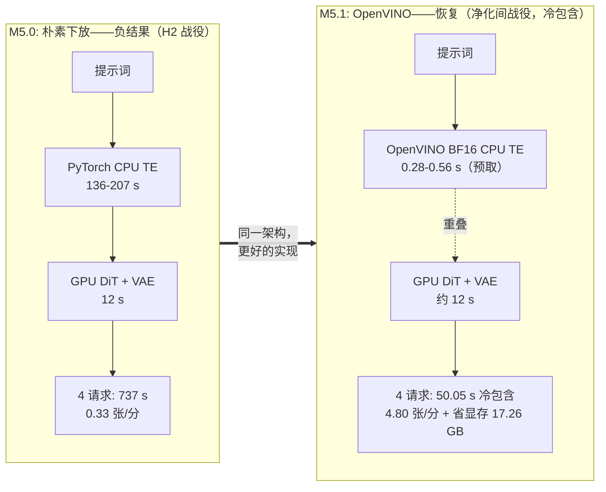

# 让生成式 AI 更快

*从算法优化原理到可复现的系统性能提升 —— 一门以 Qwen-Image-2.1 × AMD ROCm 为载体、
证据优先的推理优化动手课程。*

**Making Generative AI Faster — from algorithmic insights to measurable
system performance.**
English version: [README.md](README.md) · 课程：[English](README.md) / 中文

下文每一个主张都能追溯到在单块 AMD Radeon PRO W7900（gfx1100、48 GB、ROCm 7.2.1、
PyTorch 2.9.1）上实测并提交的运行记录——而你可以自己在免费的 Radeon Cloud GPU 上
复现整套方法论。

---

## 交互式 Jupyter 实践：学完原理立即验证

**[9模块中文 Notebook 实验入口](notebooks/README.zh-CN.md)** · [English Labs](notebooks/README.md) · [M1 基准统计 Notebook](notebooks/01_baseline_and_uncertainty.zh-CN.ipynb)

本课程现有**9个实践主题、18本中英文对照的可执行 Notebook**，提供三种声明模式：`REFERENCE`（离线 CPU 分析冻结实验数据——GitHub CI 配置）、`GPU_CLASSROOM`（你自己在 W7900 上的有界实测——Radeon Cloud 入门后的默认实验体验）、`GPU_RESEARCH`（完整冻结协议）。在第一个单元设置 `COURSE_MODE` 后 Restart & Run All；准入横幅会显示已准入的 GPU 或确切阻断原因。物理 GPU 测量是首要的实践验证方式，已提交证据仍是参考与科学对照来源。课堂练习是有界教学实验——正式加速结论需要研究协议。

**学生独立性：** 全新克隆里包含教师已提交的物理记录，因此笔记本展示的每个数字都绑定机器校验的来源（`CURRENT_SESSION_PHYSICAL` … `BLOCKED`，见[溯源契约](docs/notebook-gpu-qualification/STUDENT_PROVENANCE_CONTRACT.md)）——已提交的教师运行绝不可能被当作你自己的测量；复用必须给出精确 run id；M5.1 的 OpenVINO 工件准入严格 fail closed（`PASS` / `PASS_WITH_WARNINGS` / `FAIL` / `BLOCKED`）。

## 实测结果（真实、已测、如实附带但书）

同提示词、同种子、同 GPU——改变的是工程，同时改变的还有模型变体、采样调度与精度：

| B0 冻结基线 · bf16、40 步 · **55.21 s** | BEST · turbo-int8、8 步 · **9.02 s** |
|:---:|:---:|
|  |  |
|  |  |

**端到端实测 6.12×**（热态中位数；B0 汇集两个独立 9 次会话，其余 n=9，1024×1024）：

| 阶段 | 配置 | 热态 | 相对基线 | 峰值 VRAM |
|---|---|---|---|---|
| **B0** | bf16、40 步（冻结基线） | 55.21 s | 1.00× | 37.7 GB |
| L1 | Turbo 8 步（*减少计算*） | 12.13 s | 4.55× | 37.7 GB |
| F1 | ck 注意力（*加速计算*） | 45.09 s | 1.22× | 37.7 GB |
| F2 | INT8 权重（*显存优先：−6.7 GB*） | 51.09 s | 1.08× | **31.0 GB** |
| **BEST** | Turbo INT8 + 默认注意力 | **9.02 s** | **6.12×** | **31.0 GB** |

> ⚠ **诚实的但书（本课程的核心价值）：** 6.12× 同时改变了模型变体（turbo）、调度
> （8 步）与精度（INT8）——不是看不见的实现细节——因此 BEST 的图像与 B0 合法地不同
> （LPIPS 距离 0.19–0.30；INT8 本身近乎无损，保真度 0.005–0.031 vs 0.0000 噪声底）。
> turbo 的输出是否可接受、尤其是原生分辨率下的海报排版，是一个**人工三级判定
> （无感/略降/不可接受），对 BEST 而言仍为 `PENDING_HUMAN_REVIEW`**——与下文 M5.1
> 的判定是相互独立的门。速度永远不能凌驾质量门。完整网格：
> [`evidence/quality/BEST/quality_grid.png`](evidence/quality/BEST/quality_grid.png) ·
> 原生分辨率裁切：[`quality_crops_poster.png`](evidence/quality/BEST/quality_crops_poster.png)。

## 最有教学价值的剧情线：一个负结果的恢复——以及它的天花板

这是本课程的旗舰故事，在
[M5.0](course/M05_parallel_heterogeneous/LESSON.zh-CN.md) →
[M5.1](course/M05_parallel_heterogeneous/M5_1_OPENVINO_CPU_TE.zh-CN.md)
中完整讲授：

1. **M5.0（负结果）：** 把 8B 文本编码器下放到 CPU 释放 16.8 GB 显存，却慢
   152–391×；即便有 50.4 s 被时间戳证明的 CPU+GPU 重叠，流水线执行仍在吞吐上
   **输 14×**。
2. **M5.1（恢复）：** 更好的 CPU *实现*——OpenVINO BF16——让 CPU 编码变得可用：
   正提示词**快 331–480×**、条件张量 PASS、**峰值显存 −17.26 GB**、质量已被
   所有者接受（2026-11-05，范围仅限 C1b 对比 G）。其 INT8 兄弟臂**未通过空负向
   条件门（relL2 28.25%）**，保持探索性——任何主观接受都不能推翻数值 FAIL。
3. **M5.1（教训）：** 局部增益 ≠ 系统增益。热态单请求服务延迟改善 **1.081×**
   （13.031 → 12.060 s），而实际四请求批量吞吐只改善 **1.029×**（4.42 → 4.55
   张/分）——三个不同的问题、三个不同的数字（冷包含：1.33×）、同一个 Amdahl
   天花板。
4. **客户端教训（测量测量者）：** 基准客户端本身成了瓶颈的一部分——每请求
   约 0.5–1.0 s 的监视器拆除开销藏在**两个臂**的批次间隙里。只修 C 的客户端
   （+4.85%，诚实地差一点没到预注册的 5% 探索目标）会让"C 对 A"的"架构"引述
   悄悄测到测量装置。对照性的 2×2 追加实验——{A, C} × {原客户端, 快客户端}
   ——是本课程的旗舰公平性实验
   （[P4 研究](docs/publication-closure/P4_FAIR_CLIENT_AB.md)）。



*总体纪律（为什么是这些配对）：* 上图每一组 时间/吞吐 配对都来自**同一个运行
总体**——M5.0 侧是冻结的 H2 战役记录（`737.1 s → 240/737.1 = 0.33 张/分`），
M5.1 侧是净化间战役的冷包含 C1b 会话（`50.05 s → 4.80 张/分`；显存为战役
热会话口径）。**热态**稳态数字刻意不进这张图，因为它们回答的是另一个问题——
见上文第 3 条（服务 1.081×、实际批量吞吐 1.029× = 4.42 → 4.55 张/分）。
跨总体混配（如 `737 s` 配 `0.35 张/分`、`50 s` 配 `4.55 张/分`）曾是本图
早期修订的真实缺陷，现由 CI 强制校验
（[`check_metric_pairs.py`](scripts/course-quality/check_metric_pairs.py)，
溯源见 [`P1_METRIC_PROVENANCE.json`](docs/publication-closure/P1_METRIC_PROVENANCE.json)）。

## 你将学到什么：让推理变快的三条路

**① 减少计算** —— 不是加速一个操作，而是删掉它。步数蒸馏 40 → 8 是最大的单杠杆
（4.55×）——但不是 5×（Amdahl 封顶 ≈4.6×），每步成本不变（1.345 → 1.337 s），
而输出合法地改变 → 一笔必须由人裁决的质量交易。

**② 加速计算** —— 同样的工作，更快的内核。注意力后端（ck：1.22×）与 INT8
（1024² 下 1.08×，但显存 −6.7 GB）。独立收益永不相乘（4.55 × 1.08 × 1.25 会
"预测"出 6.14×；实测 6.12×——而 ck 在 int8-turbo 路径上加*零*：9.023 vs 9.022 s，
分布完全重叠）。

**③ 并行与异构计算** —— 把工作搬到正确的引擎并重叠执行。M5.0/M5.1 用硬方式
实测：回报等于你搬走的关键路径占比，减去你添加的每一次交接。

方法论主线——*测量 → 建模 → 假设 → 优化 → 验证 → 解释 → 复现 → 贡献*——在
[course/METHODOLOGY.zh-CN.md](course/METHODOLOGY.zh-CN.md) 中显式讲授，并在每个
模块中应用。

## 三步开始（约 15 分钟出第一张图）

**1 · 申请免费 Radeon Cloud GPU。** 经
[Radeon Cloud 登录页](https://developer.amd.com.cn/login?source=WmhWQBvrH)申请
（中文图文教程：
[申请与使用教程](https://mp.weixin.qq.com/s/dOAIzJ2qsWPmBSH67q41aA)；文档：
[radeon-cloud-docs 中文](https://amd-aim.github.io/radeon-cloud-docs/zh-cn/)），
然后启动**单 GPU Linux Notebook（PyTorch-ROCm 镜像）**。
要求：约 60 GB 可用磁盘（25.5 GB 固定模型 + ComfyUI）；完整课程需 gfx1100 级
48 GB GPU（24 GB 卡可跑冒烟变体与全部证据阅读轨道）。配额以平台控制台显示为准——
本课程从不承诺具体数字。[真实实例的就绪审计 →](docs/RADEON_CLOUD_READINESS.md)

**2 · 把课程克隆到 `/workspace`：**

```bash
cd /workspace
git clone https://github.com/AIwork4me/qwen-image-inference-tuning-course.git
```

**3 · 一条命令，拿到第一张图：**

```bash
cd qwen-image-inference-tuning-course
bash scripts/cloud/start.sh
```

脚本会诊断实例、借用预装的 ROCm PyTorch（绝不重装）、按固定提交获取 ComfyUI、
分阶段下载 SHA256 固定的最小模型集（约 25.5 GB，支持断点续传）、运行失败即拒绝的
doctor，并生成一张有界冒烟图（路径会打印出来）。
[完整快速开始 + 经实测的恢复指南 →](docs/RADEON_CLOUD_QUICKSTART.zh-CN.md)

**还没有 GPU？** 每个模块都有 `REFERENCE` 模式：读已提交的测量、重算加速比、
剖析数据——并提交纯 CPU 的改进 PR（见下方[学习轨道 A](#选择你的学习轨道)）。

## 选择你的学习轨道

| 轨道 | 适合谁 | 时间 | 做什么 |
|---|---|---|---|
| **A — REFERENCE**（无需 GPU） | 所有人 | 2–4 小时 | 阅读已提交运行记录、重算比值、审视主张与证据、通过 PR 改进文档/测试 |
| **B — GPU_CLASSROOM**（你的 W7900 默认模式） | 已完成入门的学生 | +2–3 小时 | 每模块产出自己的有界物理测量（约 5 分钟/臂、1 提示词），自动标注 `BOUNDED_PHYSICAL_COMPARISON` |
| **C — GPU_RESEARCH**（完整复现） | 进阶学习者 | +6–10 小时 GPU | 严格 doctor、固定模型、完整协议（3 提示词 × 3 种子）、重复 A/B、质量门、不确定度、贡献 |

详情：[docs/CLASSROOM_WORKFLOWS.zh-CN.md](docs/CLASSROOM_WORKFLOWS.zh-CN.md) ·
English: [docs/CLASSROOM_WORKFLOWS.md](docs/CLASSROOM_WORKFLOWS.md)

## 课程结构（8 学时 + 实验 + 100 分钟讲义）

| 模块 | 讲什么 | 关键实测事实 |
|---|---|---|
| [M0 环境与纪律](course/M00_setup_and_discipline/LESSON.zh-CN.md) ([EN](course/M00_setup_and_discipline/LESSON.md)) | 失败即拒绝的预检、证据文化 | doctor 门、固定技术栈 |
| [M1 基线](course/M01_baseline/LESSON.zh-CN.md) ([EN](course/M01_baseline/LESSON.md)) | 先测量再优化 | 55.21 s、1.345 s/步、可复现性 |
| [M2 剖析](course/M02_profiling/LESSON.zh-CN.md) ([EN](course/M02_profiling/LESSON.md)) | 流水线 + 内核追踪、Amdahl | GEMM 61.3% / 注意力 32.4%（占繁忙） |
| [M3 减少计算](course/M03_less_computation/LESSON.zh-CN.md) ([EN](course/M03_less_computation/LESSON.md)) | 步数蒸馏、归因 | 4.55×——以及为什么不是 5× |
| [M4 加速计算](course/M04_faster_computation/LESSON.zh-CN.md) ([EN](course/M04_faster_computation/LESSON.md)) | 注意力后端、INT8、组合 | ck 1.22×；INT8 1.08× + 显存收益；LF2=LF3 |
| [M5.0 PyTorch CPU 基线](course/M05_parallel_heterogeneous/LESSON.zh-CN.md) ([EN](course/M05_parallel_heterogeneous/LESSON.md)) | CPU TE 下放/流水线为何会输 | 实测 14× 吞吐损失 |
| [M5.1 OpenVINO CPU TE](course/M05_parallel_heterogeneous/M5_1_OPENVINO_CPU_TE.zh-CN.md) ([EN](course/M05_parallel_heterogeneous/M5_1_OPENVINO_CPU_TE.md)) | 同机 A/B、精度门、三个加速比 | 331–480×；服务 1.081× vs 批量 1.029×；−17.26 GB |
| [M6 组合与质量门](course/M06_combined_quality/LESSON.zh-CN.md) ([EN](course/M06_combined_quality/LESSON.md)) | BEST 选择、LPIPS 语义 | 6.12×；人工判定具有约束力 |
| [M7 学生挑战](course/M07_student_challenge/CHALLENGES.zh-CN.md) ([EN](course/M07_student_challenge/CHALLENGES.md)) | 开源贡献实践 | 7 个分级任务 + Fork→PR 教程 |

完整大纲：[course/SYLLABUS.zh-CN.md](course/SYLLABUS.zh-CN.md) ·
[English](course/SYLLABUS.md) · 方法论：
[中文](course/METHODOLOGY.zh-CN.md) · [EN](course/METHODOLOGY.md) ·
讲义（2026-11-19，100 分钟）：[中文](course/LECTURE_DEMO.zh-CN.md) ·
[EN](course/LECTURE_DEMO.md)

## 亲手运行实验

```bash
bash scripts/cloud/start.sh --all-models   # 分阶段安装（也可后续补模型）
.venv-lab/bin/python -m lab doctor         # 严格预检（正式运行）
.venv-lab/bin/python -m lab baseline       # 冻结 B0 基线（W7900 级约 16 分钟）
.venv-lab/bin/python -m lab profile        # 流水线 + rocprofv3 内核剖析
.venv-lab/bin/python -m lab run --experiment L1 [--smoke]   # F1 F2 LF1-3 BEST H1 H2
.venv-lab/bin/python -m lab quality --experiment F2
.venv-lab/bin/python -m lab report [--scope reference|student|all] [--write]
```

**GPU 时间是计量的学习资源。** 课堂作业使用有界 `--smoke` 变体（1–3 分钟）；完整
正式会话每次 4–16 分钟（预算表见[快速开始](docs/RADEON_CLOUD_QUICKSTART.zh-CN.md)）。
缓慢的 CPU 实验（H1/H2）默认从已提交证据讲授，自主选做。空闲时请停止或销毁实例——
`runs/` 随 `/workspace` 持久保留。你的测量放在 `runs/`，永远无法修改 `evidence/`
下的冻结参考证据。

## 证据与可复现性

- `evidence/results/` —— 全部运行记录（计时、VRAM、注意力路径日志证据、图像哈希）、
  环境快照、剖析分析、SUMMARY 与图表；官方战役固定在
  [`lab/reference_runs.json`](lab/reference_runs.json)。
- `evidence/quality/`、`evidence/samples/` —— 配对网格、原生分辨率排版裁切、
  B0 与 BEST 实测图像。
- [docs/CLAIM_EVIDENCE_MATRIX.md](docs/CLAIM_EVIDENCE_MATRIX.md) —— 25 条主张，
  各带证据文件与但书；[course/data/verified_claims.json](course/data/verified_claims.json)
  —— 机器可校验登记表（23 条），由 CI 校验。
- [docs/REPRODUCTION_GUIDE.zh-CN.md](docs/REPRODUCTION_GUIDE.zh-CN.md) ·
  [EN](docs/REPRODUCTION_GUIDE.md) —— 精确命令与已知坑。
- [docs/case-study/](docs/case-study/) —— P0–P6 工程日志原文（阅读作业）。
- [docs/M51_RESULTS.md](docs/M51_RESULTS.md) —— M5.1 战役；
  [docs/quality-v2/](docs/quality-v2/) —— course-v2 独立审计（基线、主张、图像
  证据、流水线开销研究）。

## 提交你的第一个优化 PR

Issue → 假设 → 复现器 → 代码 → 测试 → 证据 → PR → 评审：

1. 从 [M7 挑战任务](course/M07_student_challenge/CHALLENGES.zh-CN.md)选一个
   （入门：文档/测试；进阶：受控性能实验）。
2. 遵循[贡献教程](docs/CONTRIBUTING_TUTORIAL.zh-CN.md)；保持 CPU 测试全绿
   （`python -m pytest tests/ -v`）。
3. 打开 PR 模板（`.github/PULL_REQUEST_TEMPLATE/optimization.md`）并诚实作答：
   定位到的瓶颈、改了什么、什么保持不变、前后数字、质量影响、CPU/GPU 资源成本、
   可复现性、仍未验证的主张。

带来成对测量，而不是加速故事。带证据的负结果同样欢迎，并得满分。

## 五条定律（本课程真正教的东西）

1. 先测量再优化。
2. 一次一个变量。
3. 永远不要把加速比相乘——组合必须端到端实测。
4. 速度 ≠ 质量；人工判定具有约束力。
5. 主张 ≤ 证据。

## 出处与许可

本课程衍生自社区基准项目
[AIwork4me/qwen-image-rocm](https://github.com/AIwork4me/qwen-image-rocm)
（MIT）——其 Linux W7900 工作流提供了实验代码与全部测量。代码：**MIT**。课程文本、
证据数据与报告：**CC-BY-4.0**。模型权重不包含在仓库中，归上游许可所有。详情：
[LICENSE](LICENSE)、[DATA_LICENSE.md](DATA_LICENSE.md)、[ATTRIBUTION.md](ATTRIBUTION.md)。

独立教学材料——非 AMD 或阿里/通义千问官方项目。English version:
[README.md](README.md)。
