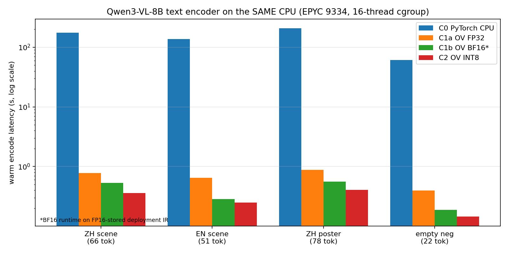
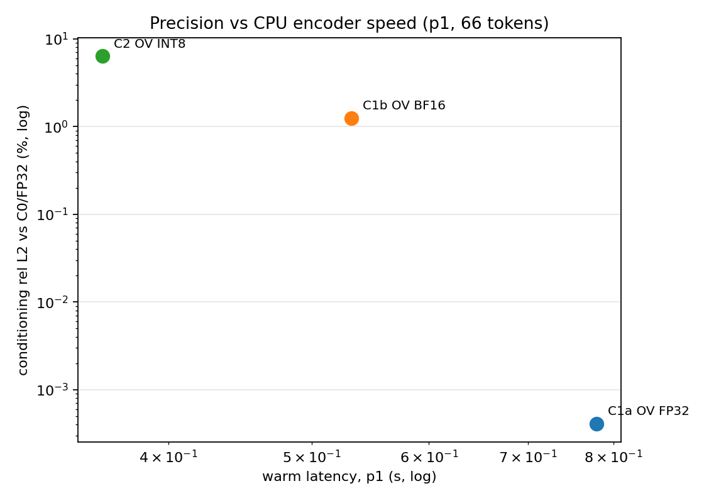
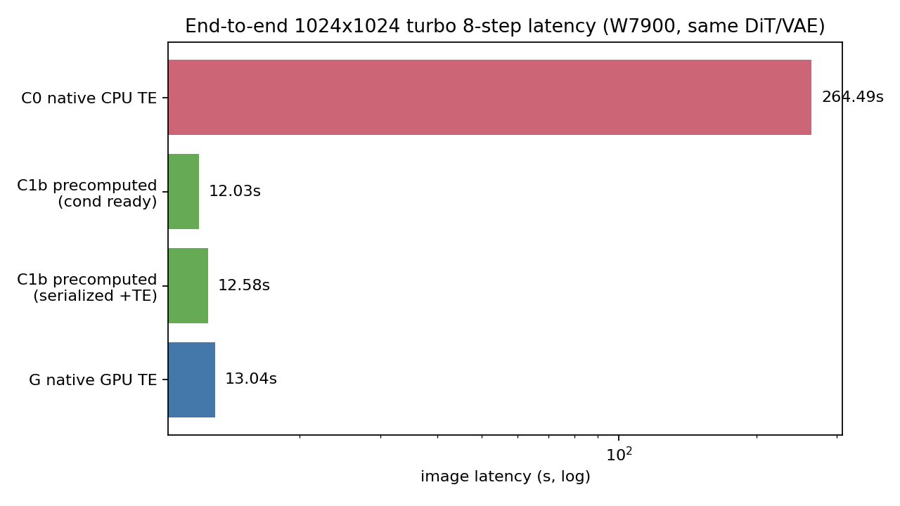
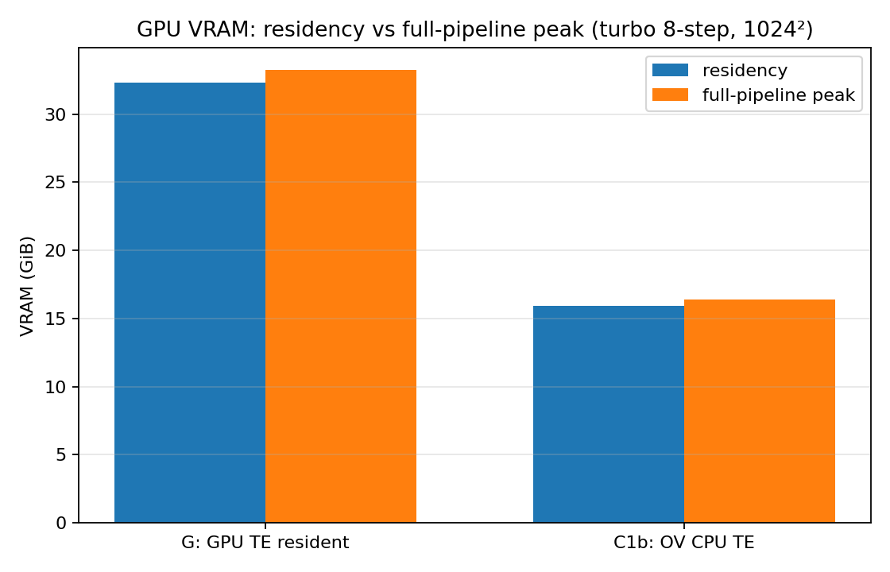
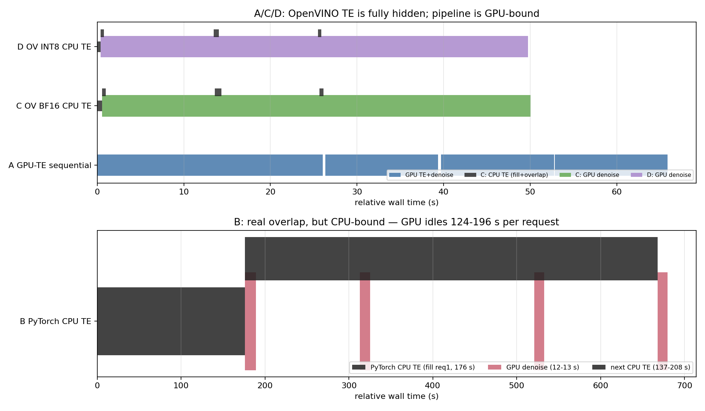

# M5.1 Results — OpenVINO CPU Text Encoder on a W7900 Linux Host

**Decision:** **GO** for the OpenVINO BF16 CPU text-encoder deployment pattern.
**INT8:** numerically valid for positive prompts, but **FAILS the declared negative-conditioning gate**; exploratory only.
**Human image-quality verdict:** `PENDING_HUMAN_REVIEW`.
**Run:** `runs/m51-20261105-cleanroom-01/` (2026-11-05, clean room, gfx1100 48 GB GPU).
**Source HEAD at measurement:** `20a7f7e5afcb078b3899470365464f4922db10cb` (+ the implementation commits that add the lab code).

This document reports **only locally measured numbers**. Historical M5.0 and upstream reference numbers are labelled as such.

---

## 1. Executive answer

| Question | Local answer |
|---|---|
| Can OpenVINO accelerate the Qwen3-VL-8B text encoder on the same CPU? | **Yes.** Warm encoder latency falls from **176.0/136.8/207.4 s** (PyTorch CPU C0) to **0.532/0.285/0.555 s** (OV BF16 C1b) for 66/51/78-token prompts: **331–480×** on positive prompts (**328×** on the empty negative). |
| Does it preserve Qwen-Image conditioning? | **Yes for FP32 and BF16-deployment.** C1a FP32 rel L2 **3–5×10⁻⁶**; C1b BF16 deployment rel L2 **1.09–1.25%** on positive prompts, **1.91%** on the empty negative. Exact token IDs and `[1, seq, 4096]` pre-final-RMSNorm semantics verified. |
| What does INT8 add? | 0.249–0.406 s warm (**488–549×** vs C0), 16.8 GB RSS, but **5.6–6.4%** positive conditioning error and **28.3%** on the empty negative. Positive prompts are close to the declared INT8 envelope; the negative path is not. |
| How much GPU memory is saved? | **17.26 GB full-pipeline peak** and **16.80 GB residency** in the measured turbo 8-step 1024² configuration (native G 34.15 GB peak → precomputed C1b 16.77 GB). This is measured, not assumed from the TE allocation. |
| Does faster CPU encoding improve E2E latency? | **Only slightly.** Warm native GPU-TE image latency **13.03 s**; C1b precomputed cond image **12.03 s**, or **≈12.58 s** if the 0.55 s CPU encode is serialized. **~3–8%** warm improvement, not 300×. |
| Does a four-request CPU/GPU pipeline help? | **Yes, but the ceiling is the GPU.** C: **50.05 s / 4.80 img/min** vs A cold-inclusive **66.62 s / 3.60 img/min** (1.33×) and A steady-state estimate **52.13 s / 4.60 img/min** (1.04×). B (PyTorch CPU) is CPU-bound: **680.0 s / 0.35 img/min**. Audit refinement (measured, warm): per-request service latency 1.081× better but **actual batch throughput only 1.029×** (4.42→4.55 img/min) once the precomputed arm's ≈0.56 s/request orchestration overhead is included — see the release-closure latency-vs-throughput recomputation. |
| Contention? | No measurable GPU slowdown from 16-thread CPU encoding: B/C/D generation stays at **12.07–12.19 s** vs A **13.03 s** (A includes its GPU TE). |
| Best deployment? | **Persistent OpenVINO BF16 CPU worker + safetensors conditioning + unchanged GPU DiT/VAE**, with a bounded request queue. INT8 only for experiments where a different valid image sample is acceptable. |

---

## 2. What was built

```text
ComfyUI / ROCm W7900 process
   |  request: prompt -> conditioning file
   v
Persistent OpenVINO CPU worker (no per-request reload/compile)
   |  validated [1, seq, 4096] FP32 pre-final-RMSNorm tensor
   v
LinuxLabCondSafetensors (ComfyUI custom node, no pickle)
   |
   v
Original Qwen-Image-2.1 turbo BF16 DiT + original VAE -> PNG
```

New implementation files:

- `lab/ov_export.py` — clean FP32 export of the 36-layer Qwen3-VL text model from the pinned ComfyUI safetensors.
- `lab/ov_compress.py` — FP16-stored deployment IR; BF16 is the execution hint.
- `lab/ov_quantize.py` — NNCF INT8_ASYM weights, ratio 1.0, group size −1.
- `lab/ov_encoder.py` — persistent CPU encoder, ComfyUI `QwenImage21Tokenizer`, exact pre-final-RMSNorm output and second-`<|im_start|>` trim.
- `lab/ov_worker.py`, `lab/pt_worker.py` — JSON-lines persistent workers with atomic safetensors writes.
- `lab/custom_nodes/linuxlab_cond_safetensors.py` — safe conditioning loader.
- `lab/m51_baseline.py`, `m51_alignment.py`, `m51_perf.py`, `m51_threads.py`, `m51_longseq.py`, `m51_e2e.py`, `m51_e2e_summary.py`, `m51_pipeline.py`, `m51_pipeline_summary.py`, `m51_figures.py`.
- `lab/m51_contract.py` — pure contracts for admission, provenance, gates, budgets and result schemas.
- `scripts/m51/provision_ov.sh` — **optional** provisioning; never part of the default M0–M4 bootstrap.

CLI:

```bash
.venv-lab/bin/python -m lab run --experiment H3_OV_BF16 --smoke
.venv-lab/bin/python -m lab run --experiment H3_OV_BF16
.venv-lab/bin/python -m lab run --experiment H3_OV_INT8 --smoke
```

---

## 3. Headline measurements

### 3.1 Same-CPU encoder A/B (16-thread cgroup quota)

| Arm | CPU/GPU | p1 66 tok | p2 51 tok | p3 78 tok | empty neg 22 tok | cold→first | CPU RSS |
|---|---|---:|---:|---:|---:|---:|---:|
| **C0** PyTorch CPU (ComfyUI FP32 manual-cast) | CPU | **176.02 s** | **136.81 s** | **207.45 s** | **61.51 s** | 179.4 s | 34.5 GB |
| **C1a** OV FP32 | CPU | 0.779 s | 0.648 s | 0.875 s | 0.398 s | 95.0 s | 50.5 GB |
| **C1b** OV BF16* | CPU | **0.532 s** | **0.285 s** | **0.555 s** | **0.187 s** | **5.5 s** | **30.0 GB** |
| **C2** OV INT8 | CPU | 0.361 s | 0.249 s | 0.406 s | 0.144 s | 7.2 s | 16.8 GB |

\* C1b = FP16-stored deployment IR executed with `INFERENCE_PRECISION_HINT=bf16`. The BF16 **storage** variant (FP32 IR + BF16 hint) is reported separately in `M51_CONDITIONING_ALIGNMENT.md`.

Speedup vs C0: **C1a 226/211/237/155×**, **C1b 331/480/374/328×**, **C2 488/549/511/427×** (p1/p2/p3/negative).
The C0 timings reproduce the historical M5.0 CPU evidence (177.8/136.8/207.1 s) within **1%**.

### 3.2 Conditioning fidelity

| Comparison | rel L2 (positive) | cosine | Negative rel L2 | Gate |
|---|---:|---:|---:|---|
| G (GPU PyTorch) vs C0 (CPU PyTorch) | 7×10⁻⁶ | 1.000000 | 3.1×10⁻⁵ | reference |
| **C1a OV FP32 vs C0** | **3–5×10⁻⁶** | **1.000000** | 5.4×10⁻⁶ | **PASS** |
| **C1b OV BF16* vs C0** | **1.09–1.25%** | ≥0.99991 | **1.91%** | **PASS** |
| C1b-uncompressed (FP32 IR + BF16 hint) vs C0 | 1.16–1.32% | ≥0.99991 | 6.63% | **FAIL negative** |
| **C2 OV INT8 vs C1a** | **5.6–6.4%** | ≥0.9979 | **28.25%** | **FAIL negative** |

Token IDs are exactly equal across all arms; shapes `[1,52,4096]`, `[1,37,4096]`, `[1,64,4096]`, `[1,8,4096]`; all tensors finite; repeated hashes identical within each arm.

### 3.3 End-to-end images on the W7900

Same turbo BF16 DiT, VAE, seed 42, 8 steps, 1024², cfg 1.0.

| Arm | Image latency (warm) | PSNR vs G | SSIM vs G | LPIPS vs G | VRAM peak |
|---|---:|---:|---:|---:|---:|
| G native GPU TE | 13.03 s | — | — | — | 34.15 GB |
| C1a OV FP32 | 12.03 s* | 34.74–48.62 dB | 0.9885–0.9974 | 0.0015–0.0106 | 16.95 GB |
| **C1b OV BF16** | **12.03 s*** | **35.57–47.03 dB** | **0.9876–0.9972** | **0.0019–0.0080** | **16.77 GB** |
| C2 OV INT8 | 12.04 s* | 27.37–38.77 dB | 0.9483–0.9941 | 0.0081–0.0378 | 16.92 GB |
| C0 native CPU TE | **264.49 s** | 34.97 dB | 0.9887 | 0.0090 | 33.10 GB peak |

\* Precomputed conditioning; the encoder itself is 0.14–0.56 s and is not inside the 12.03 s image time. Serialized fresh-prompt C1b ≈ **12.58 s**.

C0 native and C1a FP32 produce **comparable image differences from G** (p1 LPIPS 0.0090 vs 0.0106). A tiny conditioning difference is amplified by diffusion; this is not evidence that OpenVINO is worse than the existing CPU baseline.

### 3.4 Four-request pipeline (actual timestamps)

| Arm | Total (4 requests) | Fill | CPU TE median | GPU denoise | Images/min | Bound | Proven overlap |
|---|---:|---:|---:|---:|---:|---|---:|
| A GPU TE sequential | 66.62 s | — | 0.60 s (in GPU gen) | 13.03 s | 3.60 (steady est. 4.60) | GPU | — |
| B PyTorch CPU TE | **680.00 s** | 176.17 s | **147.14 s** | 12.07 s | **0.35** | **CPU** | 37.09 s |
| **C OV BF16** | **50.05 s** | 0.56 s | 0.436 s | 12.19 s | **4.80** | GPU | 1.62 s |
| **D OV INT8** | **49.75 s** | 0.40 s | 0.405 s | 12.13 s | **4.82** | GPU | 1.40 s |

C vs A: **1.33×** cold-inclusive, **1.04×** steady-state. B is **0.098×** (10× slower than A).

---

## 4. Interpretation

1. **Why C0 is slow:** ComfyUI's CPU text path uses BF16 storage with FP32 manual-cast compute, per-op casts, and non-oneDNN custom attention. It is not a tuned CPU GEMM baseline. The measured 176–207 s is the course's real M5.0 path, reproduced within 1%.
2. **What OpenVINO changes:** a compiled CPU graph with oneDNN BF16/INT8 kernels, persistent weights, no per-op cast, controlled 16 threads, and one-time compilation. That is why the encoder-only gain is 155–549× across arms (C1b 328–480×).
3. **Why E2E barely moves:** the 8-step turbo denoiser is **10.7–10.9 s** and the VAE **0.88 s**. A 0.55 s encoder is ~4% of the cycle. Once the encoder is hidden, the pipeline is GPU-bound; the Amdahl ceiling is about **1/(1−0.05) ≈ 1.05×**.
4. **Where the large pipeline gain comes from:** the first request after idle avoids reloading a **16.8 GB GPU CLIP** in C/D, so cold-inclusive 4-request time drops 66.6 → 50.0 s. In steady state the gain is only ~4%.
5. **Precision cost:** BF16 deployment is within 1.25% on positive prompts and passes the gate; INT8 is 5.6–6.4% positive but **28% on the empty negative**, so it is not the production recommendation for cfg>1.
6. **Memory value is real and measured:** removing GPU TE residency saves **17.26 GB of full-pipeline peak**, not just an allocation. The number is configuration-specific (turbo 8-step 1024²); a 40-step BF16 DiT has a different peak and may not realize the same full reduction.
7. **No universal AMD claim:** this is one EPYC 9334 + gfx1100 host under a 16-CPU/55 GiB cgroup. The upstream 22–69× Zen5 result and the Zen4 0.39–1.33 s numbers are not used as local measurements.

---

## 5. Evidence index

| Artifact | Path |
|---|---|
| Environment / admission | `runs/m51-20261105-cleanroom-01/environment.json` |
| M5.0 GPU/CPU baseline | `runs/m51-20261105-cleanroom-01/baseline/probe_{cuda,cpu}.json` |
| Numerical gate | `runs/m51-20261105-cleanroom-01/alignment/conditioning_alignment.json` |
| CPU A/B | `runs/m51-20261105-cleanroom-01/performance/encoder_ab.json` |
| Thread sweep | `runs/m51-20261105-cleanroom-01/performance/thread_sweep_bf16.json` |
| E2E images + metrics | `runs/m51-20261105-cleanroom-01/e2e/e2e_ab.json`, `e2e_summary.json`, `grids/`, `typography/` |
| Four-request pipeline | `runs/m51-20261105-cleanroom-01/pipeline/pipeline_ab.json`, `pipeline_summary.json` |
| Long-sequence stress | `runs/m51-20261105-cleanroom-01/ov/longseq/` |
| Figures | `docs/figures/m51_*.png` |
| Tests | `tests/test_m51_contract.py` (53 tests pass) |

## 6. Figures







## 7. Reproducibility and CI

- **53 CPU-only tests pass** (`.venv-lab/bin/python -m pytest tests/ -q`), including `tests/test_m51_contract.py` for admission classification, artifact absence/corruption, tokenizer trim, conditioning shape, numerical gates, budgets, safe paths, performance statistics, result schemas, and "blocked is never PASS".
- The GitHub Actions CPU runner does **not** execute GPU inference or claim physical-GPU results; it only validates code/contracts. GPU validation is this run.
- Run ID: `m51-20261105-cleanroom-01`. Source HEAD at measurement: `20a7f7e5afcb078b3899470365464f4922db10cb`; implementation commits follow on `feat/m5-1-openvino-cpu-te-course`.
- Exact commands and recovery: [M51_REPRODUCTION.md](M51_REPRODUCTION.md).
- Large IRs are regenerable with `scripts/m51/provision_ov.sh`; only manifests/digests and run JSONs are committed.

Detailed reports: [Environment](M51_ENVIRONMENT.md) · [Alignment](M51_CONDITIONING_ALIGNMENT.md) · [CPU A/B](M51_CPU_AB.md) · [E2E & pipeline](M51_E2E_AND_PIPELINE.md) · [Limitations](M51_LIMITATIONS.md) · [Reproduction](M51_REPRODUCTION.md) · [Claim matrix](M51_CLAIM_EVIDENCE_MATRIX.md).
